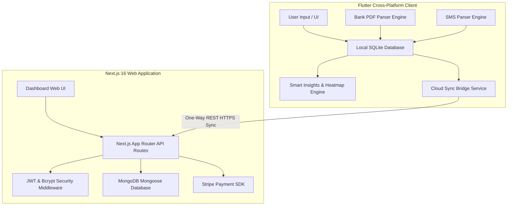
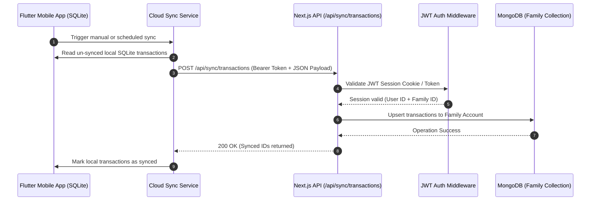
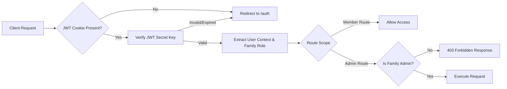
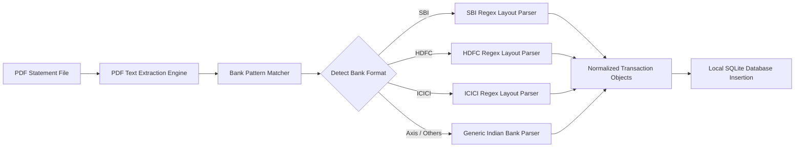
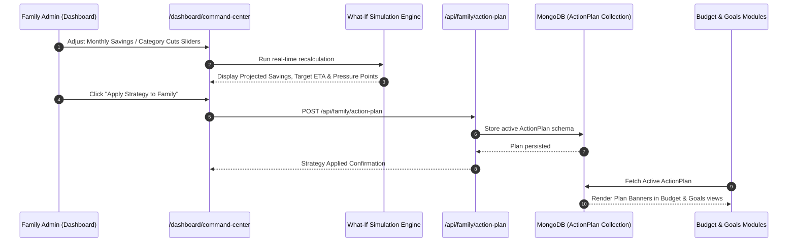

<div align="center">

  

  # 🏦 DhanMitra
  ### *Your Intelligent Financial Companion*

  <p align="center">
    <strong>An AI-powered, cross-platform Financial Operating System designed for individuals, families, and businesses to automate expense tracking, model financial scenarios, and streamline family wealth management.</strong>
  </p>

  ```bash
  ⚡ Offline-First SQLite Mobile App  |  📊 Next.js 16 Web Dashboard  |  🧠 Smart Financial Engine  |  📑 CA-Ready Reports
  ```

  <p align="center">
    <!-- Shields.io Badges -->
    <a href="https://github.com/Rachit-Kakkad1/DhanMitra/stargazers"></a>
    <a href="https://github.com/Rachit-Kakkad1/DhanMitra/network/members"></a>
    <a href="https://github.com/Rachit-Kakkad1/DhanMitra/issues"></a>
    <a href="https://github.com/Rachit-Kakkad1/DhanMitra/blob/main/LICENSE"></a>
    <a href="https://flutter.dev"></a>
    <a href="https://nextjs.org"></a>
    <a href="https://mongodb.com"></a>
  </p>

  <p align="center">
    <!-- Platform Support Badges -->
    
    
    
    
    
    
  </p>

</div>

---

## 📌 Table of Contents
- [Executive Overview](#-executive-overview)
  - [Problem Statement](#problem-statement)
  - [The DhanMitra Solution](#the-dhanmitra-solution)
  - [Vision \& Mission](#vision--mission)
  - [Target Audience \& Value Proposition](#target-audience--value-proposition)
- [System Architecture](#-system-architecture)
  - [High-Level Architecture](#high-level-architecture)
  - [Data Synchronization \& Bridge Flow](#data-synchronization--bridge-flow)
  - [Authentication \& Access Control Flow](#authentication--access-control-flow)
  - [Bank Statement Parser \& Processing Pipeline](#bank-statement-parser--processing-pipeline)
  - [Command Center Strategy \& What-If Flow](#command-center-strategy--what-if-flow)
- [Product Features](#-product-features)
- [Web Dashboard Modules](#-web-dashboard-modules)
- [Mobile Application](#-mobile-application)
- [Financial Intelligence \& AI Engine](#-financial-intelligence--ai-engine)
- [Tech Stack](#-tech-stack)
- [Repository \& File Structure](#-repository--file-structure)
- [Getting Started \& Installation](#-getting-started--installation)
  - [Prerequisites](#prerequisites)
  - [1. Mobile Application Setup (Flutter)](#1-mobile-application-setup-flutter)
  - [2. Web Dashboard Setup (Next.js)](#2-web-dashboard-setup-nextjs)
  - [3. Docker Deployment](#3-docker-deployment)
- [Environment Variables](#-environment-variables)
- [Database Architecture \& Schemas](#-database-architecture--schemas)
- [API Documentation](#-api-documentation)
- [Security \& Compliance](#-security--compliance)
- [Performance \& Scalability](#-performance--scalability)
- [Product Roadmap](#-product-roadmap)
- [Testing \& Quality Assurance](#-testing--quality-assurance)
- [Contributing Guide](#-contributing-guide)
- [Frequently Asked Questions (FAQ)](#-frequently-asked-questions-faq)
- [License \& Acknowledgements](#-license--acknowledgements)

---

## 🚀 Executive Overview

### Problem Statement
Personal and family financial management remains fragmented, manual, and reactive:
1. **Data Silos**: Bank account statements, credit cards, manual receipts, and family expenses live in isolated spreadsheets or separate banking apps.
2. **Lack of Family Cohesion**: Families lack a centralized, privacy-preserving workspace to track household expenditure, assign budgets, and execute joint financial goals.
3. **Complex Tax Handoffs**: Taxpayers and Chartered Accountants (CAs) waste countless hours aggregating transactions, categorizing deductions, and formatting monthly audit packages.
4. **Passive Analytics**: Standard apps display historical graphs without providing actionable, forward-looking scenario modeling or strategy execution.

### The DhanMitra Solution
**DhanMitra** is a complete, multi-tenant Financial Operating System built on a hybrid offline-first architecture:
- **Mobile First**: A responsive Flutter app powered by a local SQLite engine. It parses bank statements (PDFs for major Indian banks like SBI, HDFC, ICICI, Axis, Kotak) and local SMS alerts entirely on-device, preserving privacy while delivering instant insights.
- **Web Dashboard**: A state-of-the-art Next.js 16 dashboard powered by MongoDB, designed for family admins, financial planners, and CAs to review aggregate trends, execute What-If financial simulations, manage family roles, and generate certified CA reporting packs.
- **Cloud Bridge**: One-way secure synchronization linking local device transactions to MongoDB family accounts.

### Vision & Mission
- **Vision**: To become the global open-source gold standard for privacy-focused personal, family, and small-business financial management.
- **Mission**: Automate financial tracking, democratize advanced scenario modeling, and eliminate administrative friction between households and financial professionals.

### Target Audience & Value Proposition
| Audience Segment | Primary Use Case | Key Value Received |
| :--- | :--- | :--- |
| **Individuals & Students** | Daily expense logging, SMS parser, budget suggestions, savings goals | Automated transaction entry, offline availability, zero privacy leakage |
| **Families & Couples** | Household expense sharing, role-based member permissions, joint budget planning | Unified financial clarity, invite-based family management, fair expenditure tracking |
| **Chartered Accountants (CAs)** | Monthly tax audit packages, tokenized temporary access links, CSV/PDF exports | Automated CA report scheduling, zero manual data formatting, instant audit trails |

---

## 📐 System Architecture

### High-Level Architecture
DhanMitra utilizes a hybrid client architecture consisting of an offline-first mobile application running SQLite and a cloud web application backed by Next.js App Router and MongoDB.



### Data Synchronization & Bridge Flow
Transactions captured on the mobile device are synchronized one-way to the MongoDB family workspace via encrypted REST endpoints.



### Authentication & Access Control Flow



### Bank Statement Parser & Processing Pipeline
The mobile application parses native bank PDF statements locally without uploading financial documents to external servers.



### Command Center Strategy & What-If Flow



---

## ✨ Product Features

### 📱 Mobile Experience (Flutter)
- **Offline-First Storage**: Full offline functionality using SQLite. Perform transaction logging, editing, and analytics without internet access.
- **Local PDF Bank Statement Parser**: Parses PDF statements from major Indian banks (SBI, HDFC, ICICI, Axis, Kotak, Bank of Baroda).
- **Automated Category Mapping**: Intelligently classifies raw merchant strings into standard spending categories (Food, Shopping, Bills, Transport, Health, Entertainment).
- **Smart Insights Engine**: Generates localized alerts regarding spending spikes, category budget utilization, and weekend expenditure surges.
- **Spending Heatmap & Story**: Visualizes calendar expenditure density and presents monthly spending stories in readable text summaries.
- **Budget Suggestions**: Calculates dynamic spending recommendations based on rolling historical averages.
- **Achievements & Gamification**: Unlocks progress milestones for consistent savings and habit improvements.

### 💻 Web Dashboard (Next.js 16)
- **Multi-Tenant Family Workspaces**: Create or join family workspaces using secure, 6-character invitation codes.
- **Command Center & What-If Simulator**: Experiment with dynamic scenario levers (e.g. cutting dining out by 15%, increasing emergency buffer) and view live projections.
- **Action Plan Execution**: Persist dynamic strategies as active family Action Plans that directly bind to family budget and target progress bars.
- **CA-Ready Audit Packs**: Generate complete monthly audit packages containing categorized transactions, net income metrics, and tax deduction indicators.
- **Tokenized Temporary CA Sharing**: Create passwordless, expiring public access links (`/ca-pack/[token]`) so external accountants can review and export data securely.
- **Full Audit Logging**: Log all critical administrative operations (member role changes, member removal, strategy updates, subscription changes) with downloadable CSV exports.
- **Stripe Billing Integration**: Upgrade plans, manage subscriptions, and inspect invoice histories effortlessly.

---

## 🖥️ Web Dashboard Modules

| Module Name | Route Path | Core Capabilities |
| :--- | :--- | :--- |
| **Landing** | `/` | Responsive landing page; auto-redirects authenticated users to `/dashboard`. |
| **Authentication** | `/auth` | Unified sign-in and registration flow supporting email/password and session management. |
| **Overview** | `/dashboard` | Executive KPI cards (Total Balance, Monthly Expense, Active Members, Budget Health), recent feed, quick actions. |
| **Command Center** | `/dashboard/command-center` | Interactive What-If simulation engine, strategic planning levers, and family strategy deployment. |
| **Transactions** | `/dashboard/transactions` | Filterable, paginated transaction ledger with search, category badges, and CSV exports. |
| **Analytics** | `/dashboard/analytics` | Interactive category breakdowns, member spend comparisons, and 12-month historical trend analysis. |
| **Insights & Story** | `/dashboard/insights` | Automated narrative spending stories and actionable optimization recommendations. |
| **Budget Control** | `/dashboard/budget` | Real-time budget progress bars, category pressure points, and active Action Plan strategy banners. |
| **Savings Goals** | `/dashboard/goals` | Goal health progress bars, emergency buffer tracking, and target ETA calculators. |
| **Family Members** | `/dashboard/members` | Invite code distribution, member expenditure metrics, role promotion, and administrative eviction. |
| **Audit Logs** | `/dashboard/audit` | Comprehensive activity log, forensic search filters, and audit trail CSV exports. |
| **Billing & Plans** | `/dashboard/billing` | Tier status monitoring, plan upgrades via Stripe SDK, and billing receipt history. |
| **CA Pack Studio** | `/dashboard/ca-pack` | Scheduled report setup, instant pack generation, CSV/PDF links, and tokenized share links. |
| **CA Share Portal** | `/ca-pack/[token]` | Public, expiring audit portal for external Chartered Accountants with full export tools. |
| **Account Settings** | `/dashboard/settings` | User profile updates, family creation/joining entry points, and manual transaction logging. |

---

## 🛠️ Tech Stack

### Mobile Architecture
| Layer | Technology | Purpose |
| :--- | :--- | :--- |
| **Framework** | Flutter 3.x / Dart | Cross-platform codebase for iOS, Android, Desktop, and Web |
| **Local Database** | SQLite (`sqflite`) | Offline-first relational storage engine |
| **PDF Extraction** | `syncfusion_flutter_pdf` / `pdf_text` | High-speed text extraction from bank statement documents |
| **State Management** | Provider / ChangeNotifier | Reactive state binding and dependency management |
| **UI Components** | Material Design 3 / Lucide Icons | Responsive, dark-mode compliant UI widgets |

### Web Dashboard & Backend Architecture
| Layer | Technology | Purpose |
| :--- | :--- | :--- |
| **Web Framework** | Next.js 16 (App Router) | Server-side rendering, React Server Components, API routes |
| **UI Library** | React 19 / TypeScript 5 | Type-safe, component-driven dashboard frontend |
| **Styling & Motion** | TailwindCSS v4 / Motion | Modern utility-first styling and smooth micro-animations |
| **Icons** | Lucide React | Clean, standard iconography |
| **Backend Database** | MongoDB / Mongoose ODM | Document storage for multi-tenant family structures |
| **Authentication** | JWT (`jsonwebtoken`) / `bcryptjs` | Secure stateless token authentication and password hashing |
| **Payments** | Stripe SDK (`stripe`) | Subscription management and billing automation |

---

## 📂 Repository & File Structure

```
Banking-App/
├── README.md                           # Main Repository Documentation
└── Resource/                           # Core Application Root Directory
    ├── analysis_options.yaml           # Flutter Static Linter Rules
    ├── pubspec.yaml                    # Flutter Dependencies & Project Metadata
    ├── pubspec.lock                    # Locked Dependency Tree
    ├── product.md                      # High-Level Product Specifications
    ├── hdfc_test_statement.pdf         # Sample Bank Statement for Parser Testing
    ├── sbi_test_statement.pdf          # Sample Bank Statement for Parser Testing
    │
    ├── android/                        # Android Native Project Configuration
    ├── ios/                            # iOS Native Xcode Workspace
    ├── macos/                          # macOS Native App Configuration
    ├── windows/                        # Windows Native App Configuration
    ├── linux/                          # Linux Native App Configuration
    ├── web/                            # Web Platform Runner & Favicons
    │
    ├── assets/                         # Static Branding & Graphic Assets
    │   ├── app_icon.png
    │   └── play_store_512.png
    │
    ├── docs/                           # Architectural & Delivery Strategy Docs
    │   ├── FUTURE_FEATURES.md          # Post-Hackathon System Roadmap
    │   ├── HACKATHON_DELIVERY_PLAN.md  # Delivery Specifications & Scope Locks
    │   ├── OCEANLAB_HACKATHON_EXECUTION.md # Hackathon Execution Workflow
    │   ├── page_wise.md                # Comprehensive Dashboard Page Breakdown
    │   └── dhanpath-ai.postman_collection.json # API Postman Test Collection
    │
    ├── lib/                            # Flutter Mobile Application Source Code
    │   ├── main.dart                   # Mobile Application Entry Point
    │   ├── models/                     # SQLite Data Models
    │   │   ├── transaction_model.dart
    │   │   ├── budget_model.dart
    │   │   └── account_model.dart
    │   ├── parsers/                    # Local Bank Statement Regex Parsers
    │   │   ├── bank_parser.dart
    │   │   ├── sbi_parser.dart
    │   │   ├── hdfc_parser.dart
    │   │   └── icici_parser.dart
    │   ├── providers/                  # Application State Providers
    │   │   ├── transaction_provider.dart
    │   │   ├── student_budget_provider.dart
    │   │   └── theme_provider.dart
    │   ├── screens/                    # Flutter UI Screen Views
    │   │   ├── dashboard_screen.dart
    │   │   ├── quick_expense_screen.dart
    │   │   └── monthly_report_screen.dart
    │   ├── services/                   # Application Domain Services
    │   │   ├── pdf_statement_parser_service.dart
    │   │   ├── smart_insights_engine.dart
    │   │   ├── money_personality_engine.dart
    │   │   ├── money_twin_service.dart
    │   │   ├── spending_heatmap_service.dart
    │   │   ├── spending_story_service.dart
    │   │   ├── achievement_service.dart
    │   │   └── cloud_sync_service.dart
    │   ├── usecases/                   # Business Logic Layer
    │   └── utils/                      # Helper Functions & Constants
    │
    ├── dashboard/                      # Next.js 16 Web Dashboard Application
    │   ├── package.json                # Dashboard Node Dependencies
    │   ├── tsconfig.json               # TypeScript Configuration
    │   ├── next.config.ts              # Next.js Framework Configuration
    │   ├── postcss.config.mjs          # PostCSS / Tailwind Setup
    │   ├── .env.example                # Dashboard Environment Template
    │   │
    │   └── src/
    │       ├── app/                    # Next.js App Router Structure
    │       │   ├── page.tsx            # Landing Page (`/`)
    │       │   ├── auth/page.tsx       # Auth Login / Signup (`/auth`)
    │       │   ├── dashboard/          # Authenticated Dashboard Layout & Pages
    │       │   │   ├── page.tsx        # Executive Dashboard (`/dashboard`)
    │       │   │   ├── command-center/ # What-If Simulator (`/dashboard/command-center`)
    │       │   │   ├── transactions/   # Transaction Ledger (`/dashboard/transactions`)
    │       │   │   ├── analytics/      # Financial Analytics (`/dashboard/analytics`)
    │       │   │   ├── insights/       # Insights & Story (`/dashboard/insights`)
    │       │   │   ├── budget/         # Budget Control (`/dashboard/budget`)
    │       │   │   ├── goals/          # Goal Tracking (`/dashboard/goals`)
    │       │   │   ├── members/        # Family Member Mgmt (`/dashboard/members`)
    │       │   │   ├── audit/          # Audit Trail (`/dashboard/audit`)
    │       │   │   ├── billing/        # Stripe Billing (`/dashboard/billing`)
    │       │   │   ├── ca-pack/        # CA Report Studio (`/dashboard/ca-pack`)
    │       │   │   └── settings/       # Profile & Settings (`/dashboard/settings`)
    │       │   ├── ca-pack/[token]/    # Public Tokenized CA Portal
    │       │   └── api/                # Next.js Serverless API Endpoints
    │       │       ├── auth/           # Login, Register, Logout, Me
    │       │       ├── family/         # Create, Join, Members, Action Plan, Audit
    │       │       ├── transactions/   # Transaction CRUD operations
    │       │       ├── sync/           # Mobile Cloud Sync Bridge
    │       │       ├── billing/        # Subscription & Stripe webhooks
    │       │       └── ca-pack/        # CA Pack generation & validation
    │       │
    │       ├── components/             # Reusable React Components
    │       ├── lib/                    # Shared Node/Server Utilities & DB Drivers
    │       │   ├── mongodb.ts          # Mongoose Connection Singleton
    │       │   └── auth.ts             # JWT Token Verification Helpers
    │       └── models/                 # Mongoose Database Schemas
    │           ├── User.ts
    │           ├── Family.ts
    │           ├── Transaction.ts
    │           ├── Budget.ts
    │           ├── ActionPlan.ts
    │           ├── AuditLog.ts
    │           ├── Subscription.ts
    │           └── CaPackSchedule.ts
    │
    └── test/                           # Mobile Application Unit & Integration Tests
        ├── models/
        ├── parsers/
        ├── providers/
        ├── screens/
        └── services/
```

---

## ⚡ Getting Started & Installation

### Prerequisites
Before setting up DhanMitra, ensure you have the following installed on your system:
- **Flutter SDK**: `v3.19.0` or higher
- **Node.js**: `v20.x` or higher
- **Package Manager**: `npm` (v10+) or `pnpm`
- **Database**: Active MongoDB instance (Local or MongoDB Atlas cluster)

---

### 1. Mobile Application Setup (Flutter)

```bash
# 1. Navigate to the mobile project root
cd Resource

# 2. Fetch Flutter package dependencies
flutter pub get

# 3. Analyze code for static compliance
flutter analyze

# 4. Execute unit test suite
flutter test

# 5. Launch mobile app (Select target device: Chrome, Android Emulator, iOS Simulator)
flutter run
```

---

### 2. Web Dashboard Setup (Next.js)

```bash
# 1. Navigate to the dashboard directory
cd Resource/dashboard

# 2. Install Node dependencies
npm install

# 3. Create environmental configuration file
cp .env.example .env.local

# 4. Start Next.js development server
npm run dev

# 5. Open browser application
# Access dashboard at http://localhost:3000
```

---

### 3. Docker Deployment

```bash
# Build and execute dashboard production container
cd Resource/dashboard
docker build -t dhanmitra-dashboard .
docker run -p 3000:3000 --env-file .env.local dhanmitra-dashboard
```

---

## 🔐 Environment Variables

The Next.js Web Dashboard relies on the following environment configuration parameters (`.env.local`):

| Variable Name | Required | Default / Format | Description |
| :--- | :---: | :--- | :--- |
| `MONGODB_URI` | **Yes** | `mongodb://localhost:27017/dhanmitra` | MongoDB connection string URI |
| `JWT_SECRET` | **Yes** | `super-secret-jwt-key` | Cryptographic secret key for signing auth tokens |
| `NEXT_PUBLIC_APP_URL` | **Yes** | `http://localhost:3000` | Application base URL |
| `STRIPE_SECRET_KEY` | Optional | `sk_test_...` | Stripe secret API key for billing integration |
| `STRIPE_WEBHOOK_SECRET` | Optional | `whsec_...` | Stripe Webhook verification secret |

---

## 🗄️ Database Architecture & Schemas

The Next.js backend leverages MongoDB with Mongoose ODM to manage multi-tenant family workspace data.

```
+------------------+         +------------------+
|      User        |         |      Family      |
+------------------+         +------------------+
| _id              |         | _id              |
| name             | 1     * | name             |
| email            |<------->| inviteCode       |
| password         |         | adminId          |
| familyId         |         | memberIds        |
+------------------+         +------------------+
         |                            |
         | 1                        1 |
         v                            v
+------------------+         +------------------+
|   Transaction    |         |    ActionPlan    |
+------------------+         +------------------+
| _id              |         | _id              |
| userId           |         | familyId         |
| familyId         |         | monthlySavings   |
| amount           |         | categoryCuts     |
| category         |         | targetDate       |
| date             |         +------------------+
+------------------+
```

### Key Mongoose Schemas Overview

1. **User Schema (`User.ts`)**: Stores credentials, user display names, email address, and family membership references.
2. **Family Schema (`Family.ts`)**: Represents the shared workspace, housing the primary `adminId`, array of `memberIds`, unique 6-character `inviteCode`, and workspace configuration.
3. **Transaction Schema (`Transaction.ts`)**: Core financial entry recording amount, debit/credit type, merchant string, category, date, creator user ID, and associated family ID.
4. **Action Plan Schema (`ActionPlan.ts`)**: Stores active What-If simulation parameters applied by family admins to enforce target savings across family dashboards.
5. **Audit Log Schema (`AuditLog.ts`)**: Immutable security audit feed documenting actor ID, action type, target resource, timestamp, and metadata.
6. **CA Pack Schedule Schema (`CaPackSchedule.ts`)**: Configures recurring automated CA report email schedules, delivery days, and recipient addresses.

---

## 📡 API Documentation

### Base URL
`http://localhost:3000/api`

### Standard Response Format

```json
{
  "success": true,
  "data": { ... },
  "message": "Operation completed successfully"
}
```

### Endpoint Reference Matrix

| Group | Method | Endpoint Path | Access Level | Description |
| :--- | :---: | :--- | :---: | :--- |
| **Auth** | `POST` | `/api/auth/register` | Public | Create new user account |
| **Auth** | `POST` | `/api/auth/login` | Public | Authenticate user and issue JWT cookie |
| **Auth** | `POST` | `/api/auth/logout` | Authenticated | Clear authentication session |
| **Auth** | `GET` | `/api/auth/me` | Authenticated | Return current session profile context |
| **Family** | `POST` | `/api/family/create` | Authenticated | Create a new family workspace |
| **Family** | `POST` | `/api/family/join` | Authenticated | Join family via 6-character invite code |
| **Family** | `GET` | `/api/family/members` | Authenticated | List all family workspace members |
| **Family** | `POST` | `/api/family/action-plan` | Admin | Persist What-If simulation strategy |
| **Family** | `GET` | `/api/family/audit` | Authenticated | Query paginated workspace audit trail |
| **Sync** | `POST` | `/api/sync/transactions` | Authenticated | Sync offline mobile transactions to cloud |
| **CA Pack** | `POST` | `/api/ca-pack/generate` | Admin | Generate tokenized monthly CA report |
| **CA Pack** | `GET` | `/api/ca-pack/validate` | Public Token | Validate public CA token & return data |

---

## 🛡️ Security & Compliance

DhanMitra enforces strict enterprise security primitives to ensure financial data remains protected:
1. **Password Hashing**: Cryptographic password hashing utilizing `bcryptjs` with salt rounds = 10.
2. **Stateless JWT Authorization**: Secure HTTP-only cookies containing signed JWT tokens to defend against Cross-Site Scripting (XSS) attacks.
3. **Role-Based Access Control (RBAC)**: Enforces strict administrative boundaries between Family Admins (can alter plans, evict members, schedule CA packs) and standard Family Members.
4. **On-Device Data Parsing**: Mobile bank statement parsing runs entirely within local Dart isolated execution threads. Financial PDF documents are never uploaded to third-party servers.
5. **Tokenized Public Sharing**: CA access links utilize random, high-entropy single-use access tokens with automated expiration bounds.
6. **Immutable Audit Trails**: All administrative modifications generate forensic audit logs recording actor details, target resources, and client IP metadata.

---

## ⚡ Performance & Scalability

- **Next.js App Router & React Server Components**: Minimal client-side JavaScript bundle footprint; data fetching executes directly on the server layer.
- **Indexed MongoDB Queries**: Optimized compound index configurations on `familyId + date` and `familyId + category` ensuring sub-millisecond aggregation query speeds.
- **Local SQLite Caching**: Mobile application reads data directly from local device flash storage, ensuring zero render latency even on offline networks.
- **Paginated Data Views**: All transaction tables and audit feeds implement cursor/skip pagination to handle high-volume transaction datasets smoothly.

---

## 🗺️ Product Roadmap

The table below distinguishes current production features from upcoming strategic enhancements:

| Feature Area | Description | Status | Priority | Version Target |
| :--- | :--- | :---: | :---: | :---: |
| **SQLite Offline Core** | Local expense tracking, local SMS & PDF statement parser | **Completed** | High | v1.0.0 |
| **Web Dashboard Core** | Multi-tenant family management, Next.js 16 App Router UI | **Completed** | High | v1.0.0 |
| **Command Center** | Interactive What-If financial strategy simulator & Action Plan engine | **Completed** | High | v1.0.0 |
| **CA Pack Studio** | Automated CA tax reporting, tokenized share portals, CSV/PDF export | **Completed** | Medium | v1.0.0 |
| **Mobile Cloud Sync** | One-way sync bridge sending transactions from mobile to dashboard | **Completed** | High | v1.0.0 |
| **Two-Way Realtime Sync** | Real-time multi-device sync with CRDT offline conflict resolution | 📋 *Planned* | High | v1.2.0 |
| **LLM Advisory Assistant** | Context-grounded financial AI assistant using LangChain & OpenAI | 📋 *Planned* | Medium | v1.3.0 |
| **Account Aggregator (AA)** | Direct Indian Open Banking API integration via Account Aggregator | 📋 *Planned* | Medium | v1.4.0 |
| **Receipt OCR Scanner** | Camera-based paper receipt scan using on-device ML Vision | 📋 *Planned* | Low | v1.5.0 |

---

## 🧪 Testing & Quality Assurance

DhanMitra maintains rigorous automated testing coverage across both mobile and dashboard stacks.

### Flutter Mobile Test Suite
```bash
cd Resource

# Run unit tests for models, parsers, services, and state providers
flutter test

# Run specific test suites
flutter test test/parsers/bank_parser_test.dart
flutter test test/services/smart_insights_engine_test.dart
```

### Web Dashboard Linter & Static Analysis
```bash
cd Resource/dashboard

# Execute ESLint checks
npm run lint

# Execute TypeScript type validation
npx tsc --noEmit
```

---

## 🤝 Contributing Guide

We welcome contributions from developers, designers, and financial domain experts!

### Contribution Workflow
1. **Fork the Repository**: Create your copy of `Rachit-Kakkad1/DhanMitra`.
2. **Create a Feature Branch**: Follow standard branch naming conventions:
   - `feature/add-axis-bank-parser`
   - `fix/sync-retry-logic`
   - `docs/update-api-guide`
3. **Commit Changes**: Use Conventional Commits standard:
   - `feat(parsers): add Kotak Mahindra statement parser`
   - `fix(dashboard): resolve budget progress bar calculation bug`
4. **Submit a Pull Request**: Open a PR against the `main` branch with a clear summary of changes and reference associated issue numbers.

---

## ❓ Frequently Asked Questions (FAQ)

<details>
<summary><strong>1. Is DhanMitra completely free and open source?</strong></summary>
Yes! DhanMitra is licensed under the open-source MIT License. You can inspect, modify, and host it independently.
</details>

<details>
<summary><strong>2. Does the mobile app require an active internet connection?</strong></summary>
No. The Flutter mobile application is built with an offline-first SQLite core. All SMS parsing, PDF statement parsing, category mapping, and analytics operate completely offline.
</details>

<details>
<summary><strong>3. Are my financial PDF statement files uploaded to external cloud servers?</strong></summary>
Never. Bank statement parsing executes entirely on-device inside native Dart isolated execution threads. Your PDF files never leave your device.
</details>

<details>
<summary><strong>4. How does data synchronization work between mobile and web dashboard?</strong></summary>
The mobile application features a Cloud Sync bridge that sends local SQLite transactions one-way to the MongoDB family workspace via encrypted REST HTTPS endpoints whenever you trigger a sync.
</details>

<details>
<summary><strong>5. Which Indian bank statements are currently supported by the PDF parser?</strong></summary>
DhanMitra currently includes parser templates for State Bank of India (SBI), HDFC Bank, ICICI Bank, Axis Bank, Kotak Mahindra Bank, and a fallback generic Indian bank parser.
</details>

<details>
<summary><strong>6. What is the Command Center & What-If Simulator?</strong></summary>
The Command Center is an interactive dashboard module that lets family admins experiment with spending levers (e.g., reducing entertainment spend by 20%) and immediately see how it impacts monthly savings and long-term goal timelines before committing to the plan.
</details>

<details>
<summary><strong>7. How does the CA Pack feature help during tax filing season?</strong></summary>
The CA Pack Studio aggregates monthly family expenses into formatted tax audit packages. It generates temporary, passwordless secure links (`/ca-pack/[token]`) so your Chartered Accountant can inspect transactions and download CSV/PDF reports without needing a full account login.
</details>

<details>
<summary><strong>8. Is multi-device real-time editing supported?</strong></summary>
Currently, synchronization runs one-way from mobile to dashboard. Two-way real-time conflict-free resolution (CRDT) is planned for the v1.2.0 roadmap release.
</details>

<details>
<summary><strong>9. How are family members authenticated and authorized?</strong></summary>
Family creation generates a unique 6-character invitation code. Family Admins hold permission to change roles, apply strategy Action Plans, and manage members, while standard Members have access to view and record transactions.
</details>

<details>
<summary><strong>10. Can I host the Web Dashboard on my own server?</strong></summary>
Absolutely. You can deploy the Next.js Web Dashboard on Vercel, AWS, DigitalOcean, or run it in a containerized environment using the provided Dockerfile.
</details>

<details>
<summary><strong>11. How is user authentication managed on the dashboard?</strong></summary>
Dashboard authentication relies on stateless JSON Web Tokens (JWT) signed with `jsonwebtoken` and stored in secure HTTP-only cookies, combined with `bcryptjs` password hashing.
</details>

<details>
<summary><strong>12. What databases are used across the stack?</strong></summary>
The Flutter mobile application uses SQLite (`sqflite`), while the Next.js Web Dashboard connects to MongoDB via Mongoose ODM.
</details>

<details>
<summary><strong>13. Does DhanMitra support international currencies?</strong></summary>
Yes. While default formatting prioritizes Indian Rupee (INR ₹), the codebase supports configurable locale currency formatting across UI views.
</details>

<details>
<summary><strong>14. How do I run automated unit tests for statement parsers?</strong></summary>
Execute `flutter test test/parsers/bank_parser_test.dart` from the `Resource` root directory to run the full regex statement parser test suite.
</details>

<details>
<summary><strong>15. How can I contribute new bank parser templates?</strong></summary>
You can add a new parser under `lib/parsers/`, implement the `BankParser` base interface, add regex patterns for the target bank, and submit a pull request!
</details>

---

## 📜 License & Acknowledgements

### License
This project is licensed under the **MIT License** - see the [LICENSE](LICENSE) file for complete details.

### Acknowledgements & Inspiration
- **Flutter & Dart Team**: For providing an exceptional cross-platform UI framework.
- **Next.js & Vercel**: For pioneering the App Router and serverless web architecture.
- **Lucide Icons**: For providing clean, modern iconography.
- **Open Source Financial Community**: For inspiring open, privacy-centric personal wealth tools.

---

<div align="center">

  <p>
    <strong>DhanMitra</strong> • Built with ❤️ for Financial Intelligence & Open Source Excellence
  </p>

  <p>
    <a href="#-dhanmitra">Back to Top ⬆️</a>
  </p>

</div>
